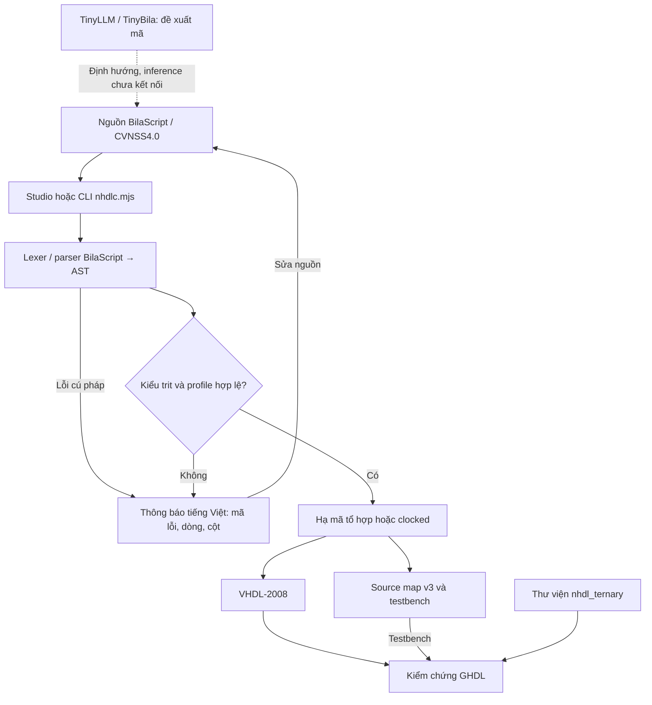
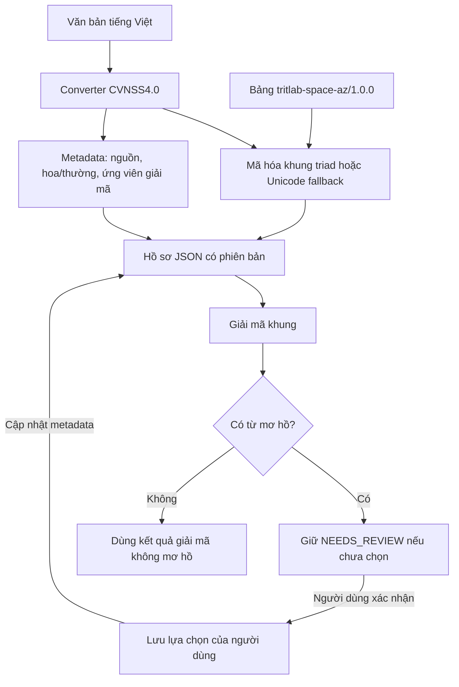
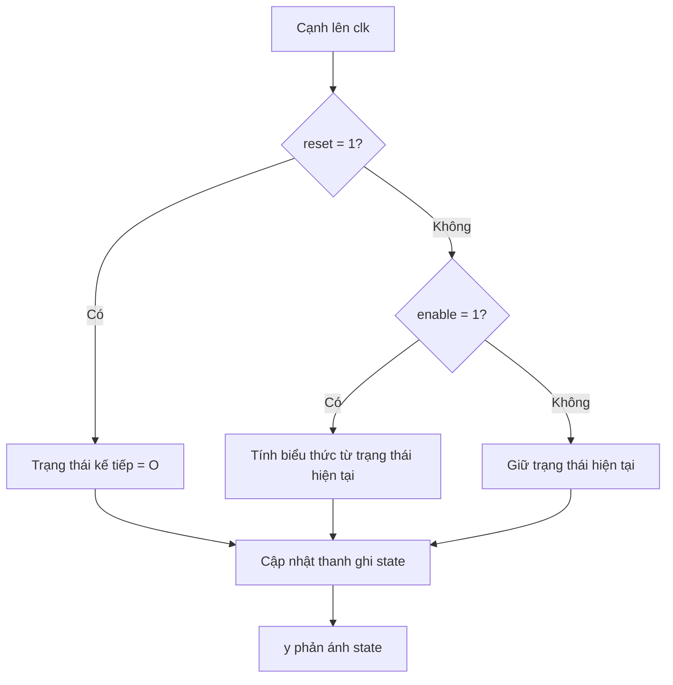
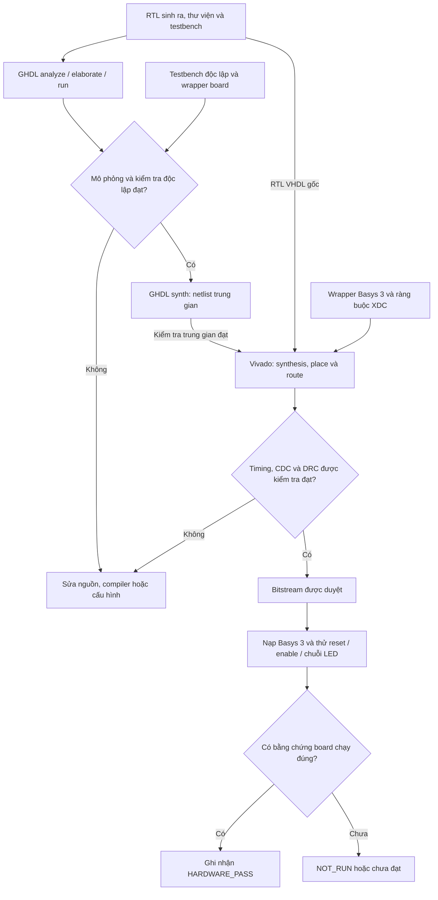

# Neutral Hardware Description Language — NHDL 0.5

NHDL là phần mở rộng thư viện tam phân của VHDL-2008, kèm compiler cho tập con BilaScript dựa trên từ vựng CVNSS4.0. Tên kiến trúc tùy chọn: Nexus. Mục đích: giảng dạy, nghiên cứu và thử nghiệm FPGA nhị phân. Không tuyên bố FPGA có phần tử tam phân vật lý.

## Luồng thực thi

Nguồn BilaScript/CVNSS4.0 → lexer/parser → kiểm tra kiểu → RTL VHDL-2008 + source map + testbench → GHDL → Vivado → Basys 3. Adapter văn bản/Base27 là tiện ích dữ liệu độc lập, không bắt buộc cho mọi chương trình. TinyLLM/TinyBila chỉ đề xuất mã; inference chưa kết nối, mã đề xuất vẫn phải qua compiler và kiểm chứng độc lập.


## Lưu đồ kiến trúc NHDL

### 1. Frontend, backend và các thành phần hỗ trợ



Studio và CLI dùng chung module `site/bridge/frontend.mjs`. Studio sinh mã và kiểm tra tĩnh trong trình duyệt; CLI `nhdlc.mjs --verify` mới gọi GHDL. Source map hỗ trợ truy vết về nguồn, không phải đầu vào phần cứng. Cổng kiểm tra kiểu và profile áp dụng cả với mã do người viết lẫn mã trợ lý đề xuất.

### 2. Adapter tiếng Việt và dữ liệu Base27



Adapter là nhánh xử lý dữ liệu độc lập với compiler. Giải mã khung khôi phục biểu diễn đã mã hóa; khôi phục nghĩa tiếng Việt cần metadata và xử lý mơ hồ. Bảng 27 ký hiệu không thay thế ngữ pháp BilaScript. Hiện chưa tự động nạp hồ sơ JSON này vào ROM hoặc bộ nhớ FPGA; muốn đưa văn bản lên board cần bổ sung định dạng dữ liệu và module phần cứng tương ứng.

### 3. Mạch có trạng thái: quy tắc cập nhật thanh ghi



Lưu đồ này mô tả profile `// @nhdl clocked reset=O`: reset đồng bộ có ưu tiên cao nhất. Với `inc(q)`, mỗi cạnh lên có enable cho chuỗi **O → P → N → O**. Không có cạnh lên thì thanh ghi không cập nhật. Việc gán signal và quan sát đầu ra vẫn tuân theo delta cycle của VHDL; đây chưa phải frontend FSM tổng quát.

### 4. Các cổng kiểm chứng đến FPGA thật



Vivado đọc RTL VHDL gốc cùng thư viện và wrapper; không dùng netlist GHDL làm đầu vào trong script hiện tại. Script có cổng chặn setup slack âm; review hold, đường chưa ràng buộc, CDC và DRC vẫn cần được thực hiện trước khi nạp.

**Trạng thái bản 0.5:** GHDL và kiểm thử độc lập của demo đã đạt; Vivado, timing trên FPGA và thử board thật vẫn **NOT_RUN**. Lưu đồ thể hiện quy trình nghiệm thu, không khẳng định các bước phần cứng đã chạy. Các báo cáo và hash nguồn/bitstream phải gắn với cùng phiên bản thử nghiệm.

## Dữ liệu và phép toán

| Kiểu | Quy ước |
|---|---|
| FakeTrit | BIT_VECTOR(1 downto 0): N=10, O=00, P=01, X=11 |
| FakeTriad | 6 bit / 3 trit, 27 tổ hợp hợp lệ; các mã chứa X không thuộc bảng ký hiệu |
| Bảng ký hiệu | tritlab-space-az/1.0.0: SPACE=0, A=1…Z=26 |
| ID → triad | Giá trị cân bằng bằng ID−13; trit thấp ở bits 1..0 |
| STI | Standard Ternary Inverter: N↔P, O→O; không phải set-to-1 |
| + và − | Kết quả một trit modulo cân bằng 3, không giữ carry |
| full_add | s + 3×carry = a+b+ci với đầu vào hợp lệ |

Ví dụ P+P=N; full_add(P,P,O) cho s=N, carry=P. X là mã lỗi theo hợp đồng thư viện, không phải điện áp thứ tư hoặc trạng thái Z trở kháng cao. Cổng có BUF/STI/INC/DEC/tmin/tmax/tcmp/mux; phép nhân một trit. Kiểu add_result chứa s và carry.

Song ánh 27↔27 chỉ đúng cho bảng ký hiệu đã chốt. Cú pháp chương trình còn có dấu câu, kiểu và tên; không giới hạn trong 27 ký hiệu. Chuỗi “Tôi yêu tiếng Việt” phải qua converter CVNSS4.0, lưu hoa/thường, Unicode fallback và ứng viên giải mã. Adapter không tự chọn nghĩa mơ hồ. 3 trit dùng 6 bit khi FakeTrit mã hóa 2 bit: không suy ra tiết kiệm bitstream, năng lượng hoặc LUT.

## Profile compiler nhdl-bila-rtl/0.3.0

Profile tổ hợp: một hàm, 1–3 tham số trit, trả một trit; một câu trov_ved biểu thức. Không vòng lặp/I/O/đệ quy, không optional call; tên hàm không trùng intrinsic. Source map v3 ở mức khai báo và câu trả về, chưa ánh xạ từng token.

Profile tuần tự được chọn tường minh bằng pragma, không suy đoán theo tên biến:

```bila
---bila:strict---
// @nhdl clocked reset=O
haml_sob dem(q: trit): trit {
  trov_ved inc(q);
}
```

Đúng một tham số trit biểu diễn trạng thái hiện tại; giá trị trả về là trạng thái kế tiếp. Compiler sinh cổng clk/reset/enable kiểu std_logic và y kiểu FakeTrit. Ở cạnh lên: reset=1 → O; nếu không và enable=1 → biểu thức kế tiếp; còn lại giữ nguyên. Reset đồng bộ ưu tiên enable. Phải reset trước khi sử dụng; không dựa vào giá trị khởi tạo BIT_VECTOR trong mô phỏng. Bộ đếm: O→P→N→O. Chưa hỗ trợ vector, nhiều thanh ghi, nhiều output hoặc FSM tổng quát trong frontend.

VHDL giữ ngữ nghĩa signal/process, delta cycle và thời gian. Profile frontend tuần tự không hỗ trợ after/wait; testbench dùng delay để quan sát sau cạnh xung.

## Chạy kiểm chứng

```sh
node --test nhdl/tests/web.test.cjs nhdl/tests/bridge.test.mjs nhdl/tests/state.test.mjs
make -C nhdl synth
make -C nhdl state
vivado -mode batch -source nhdl/boards/basys3/build.tcl
```

Cần Node.js, GHDL có VHDL-2008; bước cuối cần Vivado hỗ trợ Artix-7. `make state` tạo RTL từ nguồn, chạy testbench sinh tự động, testbench độc lập viết tay và wrapper board, sinh counter.ghw và netlist trung gian. verification.json chứa hash nguồn/RTL/testbench. Trình duyệt chỉ kiểm tra tĩnh và hiển thị NOT_RUN cho GHDL.

## T1–T10 và tiêu chí

| Test | Phạm vi/tiêu chí | Tình trạng bản 0.5 |
|---|---|---|
| T1 | Cổng, bảng chân trị và X | GHDL PASS |
| T2 | Cộng modulo một trit | PASS thư viện và compiler |
| T3 | Full adder 27 bộ hợp lệ, 64 bộ gồm X | GHDL PASS |
| T4 | Converter, metadata, candidates, round-trip | Node PASS; không đồng nghĩa giải mơ hồ ngôn ngữ hoàn hảo |
| T5 | Mã sinh so với oracle độc lập | PASS bộ đếm mẫu; chưa chứng minh mọi chương trình |
| T6 | Analyze/elaborate/run, reset/enable, wrapper | GHDL PASS; ASYNC_REG cảnh báo chưa hỗ trợ trong GHDL synth |
| T7 | FPGA target, route, timing, bitstream, board | Cấu hình Basys 3 có sẵn; Vivado và board NOT_RUN |
| T8 | 27 ID song ánh, biên không hợp lệ | Node + GHDL PASS |
| T9 | LUT/FF/Fmax so với baseline cùng chức năng | NOT_RUN; ≤2× là mục tiêu thử nghiệm, không phải định lý |
| T10 | CI hồi quy | Tự động T1–T6/T8 và synth trung gian; chưa có 3 phiên bản liên tiếp |

Không gộp các mục NOT_RUN thành PASS. CI không có FPGA. Đo T9 phải dùng cùng clock, reset, throughput, part, tool version và seed; tách bộ chia clock-enable khỏi datapath khi báo overhead. Muốn biết Fmax cần sweep constraint và route lại, không suy từ một lần đạt 100 MHz.

## Board tham chiếu

Basys 3 / xc7a35tcpg236-1. Clock 100 MHz, clock enable 1 Hz, không tạo clock bằng LUT. Hai tầng đồng bộ nút reset và switch enable. Nút reset là mức giữ (không đếm cạnh nút); không có chức năng single-step vật lý chống dội. Nhấn giữ BTNC ≥0,1 s để reset, SW0 bật chạy/tắt giữ; LD2=O, LD0=P, LD1=N.

Xem [quy trình board](../boards/basys3/README.md). Mốc “một board chạy đúng” chỉ hoàn thành khi lưu report timing/CDC/DRC, hash bitstream và quan sát board thật. Bản này chưa có Vivado hoặc board kết nối.
